# FALE Healthcare Platform — Database Schema & Architecture (v1.1)

> **Target Database**: PostgreSQL 16+  
> **Migration Engine**: Flyway  
> **Key Architectural Decisions**:
> - UUIDs (`gen_random_uuid()`) for all externally exposed primary keys.
> - High-precision `NUMERIC(12, 2)` for database monetary values (exposed as integer **paise** in the REST API).
> - Strict Shift Lifecycle: `start_at` and `end_at` timestamps (supporting overnight locum duties), derived hours, and minimum specialty rate floors.
> - Multi-Stage Shift Claim Lifecycle: `CLAIMED` &rarr; `CHECKED_IN` &rarr; `COMPLETED` (or `CANCELLED`, `NO_SHOW`, `DISPUTED`).
> - Financial Escrow Ledger: Complete breakdown of `gross_amount`, `platform_fee`, `tds_amount`, and `net_amount`. Automated refunds on shift rejection or cancellation.
> - Append-Only Tables: `audit_events`, `idempotency_keys`, `candidate_level_history`.
> - Admin Security: Password + TOTP MFA exclusively for Admin accounts; candidate and facility accounts are passwordless OTP.
> - Student Security: `candidate_level` is immutable by the candidate. Upgrades require admin approval via `student_upgrade_requests`, resetting KYC to `PENDING`.

---

## 1. Entity Relationship Diagram (Mermaid)

```mermaid
erDiagram
    USERS ||--o| CANDIDATE_PROFILES : "has profile"
    USERS ||--o| FACILITY_PROFILES : "has profile"
    USERS ||--o{ REFRESH_TOKENS : "issues"
    USERS ||--o{ NOTIFICATIONS : "receives"
    USERS ||--o{ SUPPORT_TICKETS : "submits"
    USERS ||--o{ COURSE_ENROLLMENTS : "enrolls"
    USERS ||--o{ HUDDLE_POSTS : "authors"
    USERS ||--o{ IDEMPOTENCY_KEYS : "executes"
    USERS ||--o{ AUDIT_EVENTS : "triggers"

    CANDIDATE_PROFILES ||--o{ CANDIDATE_DOCUMENTS : "holds"
    CANDIDATE_PROFILES ||--o| CANDIDATE_PAYOUT_METHODS : "configures"
    CANDIDATE_PROFILES ||--o{ JOB_APPLICATIONS : "applies"
    CANDIDATE_PROFILES ||--o{ SHIFT_CLAIMS : "claims"
    CANDIDATE_PROFILES ||--o{ SAVED_JOBS : "bookmarks"
    CANDIDATE_PROFILES ||--o{ STUDENT_UPGRADE_REQUESTS : "submits"
    CANDIDATE_PROFILES ||--o{ CANDIDATE_LEVEL_HISTORY : "tracks"

    FACILITY_PROFILES ||--o| FACILITY_WALLETS : "maintains"
    FACILITY_PROFILES ||--o| HOSPITAL_BANK_ACCOUNTS : "links"
    FACILITY_PROFILES ||--o{ JOB_POSTINGS : "publishes"
    FACILITY_PROFILES ||--o{ LOCUM_SHIFTS : "dispatches"
    FACILITY_PROFILES ||--o{ UNLOCKED_CANDIDATES : "unlocks"

    FACILITY_WALLETS ||--o{ WALLET_TRANSACTIONS : "records"

    JOB_POSTINGS ||--o{ JOB_APPLICATIONS : "receives"
    JOB_POSTINGS ||--o{ SAVED_JOBS : "referenced in"

    LOCUM_SHIFTS ||--o{ SHIFT_CLAIMS : "allocated to"
    MINIMUM_ROLE_RATES ||--o{ LOCUM_SHIFTS : "validates"

    HUDDLE_POSTS ||--o{ HUDDLE_COMMENTS : "has"
    HUDDLE_POSTS ||--o{ HUDDLE_FLAGS : "flagged by"

    COURSES ||--o{ COURSE_ENROLLMENTS : "taken by"
```

---

## 2. Complete Data Dictionary (All 28 Tables)

### Group A: Identity, Security & Concurrency

#### 1. `users`
| Column | Type | Constraints | Description |
| :--- | :--- | :--- | :--- |
| `id` | UUID | PRIMARY KEY, DEFAULT gen_random_uuid() | System-wide unique identifier |
| `phone` | VARCHAR(15) | UNIQUE | 10-digit mobile number (+91 format) |
| `email` | VARCHAR(150) | UNIQUE | Contact email address |
| `password_hash` | VARCHAR(255) | NULLABLE | BCrypt hash (Used ONLY for `ROLE_ADMIN`; NULL for candidate/facility) |
| `mfa_enabled` | BOOLEAN | NOT NULL DEFAULT FALSE | Whether TOTP MFA is active (Admin only) |
| `mfa_secret` | VARCHAR(255) | NULLABLE | Encrypted TOTP secret key for Admin MFA |
| `role` | VARCHAR(30) | NOT NULL, CHECK in ('ROLE_CANDIDATE', 'ROLE_FACILITY', 'ROLE_ADMIN') | Spring Security Granted Authority |
| `candidate_level` | VARCHAR(30) | CHECK in ('STUDENT', 'FRESHER', 'PROFESSIONAL') | Level for candidates; NULL for facility/admin |
| `status` | VARCHAR(30) | NOT NULL DEFAULT 'ACTIVE', CHECK in ('ACTIVE', 'SUSPENDED', 'LOCKED') | Account status |
| `is_onboarded` | BOOLEAN | NOT NULL DEFAULT FALSE | True once onboarding wizard completes |
| `failed_login_attempts` | INT | NOT NULL DEFAULT 0 | Account lockout counter |
| `locked_until` | TIMESTAMP WITH TIME ZONE | NULLABLE | Temporary lockout timestamp |
| `created_at` | TIMESTAMP WITH TIME ZONE | NOT NULL DEFAULT CURRENT_TIMESTAMP | Creation timestamp |
| `updated_at` | TIMESTAMP WITH TIME ZONE | NOT NULL DEFAULT CURRENT_TIMESTAMP | Update timestamp |
| `deleted_at` | TIMESTAMP WITH TIME ZONE | NULLABLE | Soft-delete timestamp |

#### 2. `refresh_tokens`
| Column | Type | Constraints | Description |
| :--- | :--- | :--- | :--- |
| `id` | UUID | PRIMARY KEY, DEFAULT gen_random_uuid() | Token ID |
| `user_id` | UUID | NOT NULL, REFERENCES users(id) ON DELETE CASCADE | Associated user |
| `token_hash` | VARCHAR(255) | NOT NULL UNIQUE | SHA-256 hash of random token |
| `expires_at` | TIMESTAMP WITH TIME ZONE | NOT NULL | 7-day expiration |
| `revoked` | BOOLEAN | NOT NULL DEFAULT FALSE | Flagged true upon rotation or logout |
| `created_at` | TIMESTAMP WITH TIME ZONE | NOT NULL DEFAULT CURRENT_TIMESTAMP | Timestamp |

#### 3. `otp_verifications`
| Column | Type | Constraints | Description |
| :--- | :--- | :--- | :--- |
| `id` | UUID | PRIMARY KEY, DEFAULT gen_random_uuid() | Verification record ID |
| `contact` | VARCHAR(150) | NOT NULL | Phone or email target |
| `otp_hash` | VARCHAR(255) | NOT NULL | Salted hash of 6-digit OTP |
| `attempts` | INT | NOT NULL DEFAULT 0 | Consecutive failed guesses (max 5) |
| `expires_at` | TIMESTAMP WITH TIME ZONE | NOT NULL | 5-minute validity |
| `verified` | BOOLEAN | NOT NULL DEFAULT FALSE | True once successfully consumed |
| `created_at` | TIMESTAMP WITH TIME ZONE | NOT NULL DEFAULT CURRENT_TIMESTAMP | Timestamp |

#### 4. `idempotency_keys`
| Column | Type | Constraints | Description |
| :--- | :--- | :--- | :--- |
| `key` | VARCHAR(100) | PRIMARY KEY | Client-supplied Idempotency-Key header |
| `user_id` | UUID | NOT NULL, REFERENCES users(id) ON DELETE CASCADE | Security principal |
| `endpoint` | VARCHAR(150) | NOT NULL | REST API path invoked |
| `response_code` | INT | NOT NULL | HTTP status code cached |
| `response_body` | TEXT | NOT NULL | Serialized JSON response cached |
| `created_at` | TIMESTAMP WITH TIME ZONE | NOT NULL DEFAULT CURRENT_TIMESTAMP | Expiration / creation timestamp |

#### 5. `audit_events` (Append-Only)
| Column | Type | Constraints | Description |
| :--- | :--- | :--- | :--- |
| `id` | UUID | PRIMARY KEY, DEFAULT gen_random_uuid() | Audit event ID |
| `actor_id` | UUID | NULLABLE, REFERENCES users(id) | Principal initiating action |
| `action` | VARCHAR(100) | NOT NULL | e.g., 'ADMIN_KYC_VERIFY', 'ESCROW_LOCK', 'PAYOUT_PAID' |
| `resource_type` | VARCHAR(50) | NOT NULL | e.g., 'SHIFT_CLAIM', 'FACILITY_WALLET' |
| `resource_id` | VARCHAR(100) | NULLABLE | Target entity ID |
| `ip_address` | VARCHAR(45) | NULLABLE | Client IPv4/IPv6 |
| `details` | JSONB | NULLABLE | Structured parameters and state changes |
| `created_at` | TIMESTAMP WITH TIME ZONE | NOT NULL DEFAULT CURRENT_TIMESTAMP | Immutable event timestamp |

#### 6. `platform_settings`
| Column | Type | Constraints | Description |
| :--- | :--- | :--- | :--- |
| `key` | VARCHAR(50) | PRIMARY KEY | e.g. 'PLATFORM_FEE_PERCENT', 'TDS_PERCENT', 'MIN_ESCROW_TOPUP_PAISE' |
| `value` | VARCHAR(255) | NOT NULL | Setting value (e.g. '5.0', '1.0', '100000') |
| `description` | TEXT | NULLABLE | Purpose of setting |
| `updated_at` | TIMESTAMP WITH TIME ZONE | NOT NULL DEFAULT CURRENT_TIMESTAMP | Timestamp |

---

### Group B: Candidate & Student Domain

#### 7. `candidate_profiles`
| Column | Type | Constraints | Description |
| :--- | :--- | :--- | :--- |
| `id` | UUID | PRIMARY KEY, DEFAULT gen_random_uuid() | Profile ID |
| `user_id` | UUID | NOT NULL UNIQUE, REFERENCES users(id) ON DELETE CASCADE | Associated user |
| `name` | VARCHAR(100) | NOT NULL | Full legal name |
| `gender` | VARCHAR(20) | NULLABLE | Gender identity |
| `dob` | DATE | NULLABLE | Date of birth |
| `city` | VARCHAR(50) | NOT NULL | Current city |
| `state` | VARCHAR(50) | NULLABLE | Current state |
| `pincode` | VARCHAR(10) | NULLABLE | Postal code |
| `address_line` | TEXT | NULLABLE | Street address |
| `course` | VARCHAR(100) | NULLABLE | Student course (e.g. B.Sc Nursing, BPT) |
| `college` | VARCHAR(150) | NULLABLE | Student college / university |
| `study_year` | VARCHAR(30) | NULLABLE | 1st year..Internship year |
| `university_reg_no`| VARCHAR(50) | NULLABLE | University bona fide student roll number |
| `expected_graduation_year` | INT | NULLABLE | Expected year of graduation |
| `profession` | VARCHAR(50) | NULLABLE | Doctor, Nurse, Physiotherapist, etc. |
| `specialty` | VARCHAR(100) | NULLABLE | Specialty/Department |
| `qualification` | VARCHAR(100) | NULLABLE | Degree / Diploma |
| `council` | VARCHAR(100) | NULLABLE | State Medical/Nursing Council |
| `reg_number` | VARCHAR(50) | NULLABLE | Government clinical license number |
| `reg_year` | VARCHAR(10) | NULLABLE | Year of council registration |
| `experience_years`| VARCHAR(30) | NULLABLE | Work experience range |
| `bio` | TEXT | NULLABLE | Profile bio / practice summary |
| `expected_salary_min_paise` | BIGINT | NULLABLE | Expected monthly compensation min (paise) |
| `expected_salary_max_paise` | BIGINT | NULLABLE | Expected monthly compensation max (paise) |
| `notice_period` | VARCHAR(50) | NULLABLE | Notice period duration |
| `kyc_status` | VARCHAR(30) | NOT NULL DEFAULT 'PENDING', CHECK in ('PENDING', 'VERIFIED', 'REJECTED') | Verification queue status |
| `kyc_notes` | TEXT | NULLABLE | Admin reviewer feedback |
| `verified_at` | TIMESTAMP WITH TIME ZONE | NULLABLE | Verification timestamp |
| `created_at` | TIMESTAMP WITH TIME ZONE | NOT NULL DEFAULT CURRENT_TIMESTAMP | Creation timestamp |
| `updated_at` | TIMESTAMP WITH TIME ZONE | NOT NULL DEFAULT CURRENT_TIMESTAMP | Update timestamp |

#### 8. `candidate_documents`
| Column | Type | Constraints | Description |
| :--- | :--- | :--- | :--- |
| `id` | UUID | PRIMARY KEY, DEFAULT gen_random_uuid() | Document ID |
| `candidate_id` | UUID | NOT NULL, REFERENCES candidate_profiles(id) ON DELETE CASCADE | Associated candidate |
| `document_type` | VARCHAR(50) | NOT NULL | COLLEGE_ID, BONAFIDE_CERTIFICATE, COUNCIL_REGISTRATION, DEGREE_CERTIFICATE, AADHAAR_KYC, RESUME |
| `file_url` | VARCHAR(500) | NOT NULL | Local path or private S3 URI |
| `original_file_name` | VARCHAR(255) | NOT NULL | Original filename |
| `file_size_bytes` | BIGINT | NOT NULL | File size in bytes |
| `mime_type` | VARCHAR(100) | NOT NULL | Validated MIME type |
| `verified` | BOOLEAN | NOT NULL DEFAULT FALSE | True if approved by admin |
| `created_at` | TIMESTAMP WITH TIME ZONE | NOT NULL DEFAULT CURRENT_TIMESTAMP | Upload timestamp |

#### 9. `candidate_level_history`
| Column | Type | Constraints | Description |
| :--- | :--- | :--- | :--- |
| `id` | UUID | PRIMARY KEY, DEFAULT gen_random_uuid() | History ID |
| `candidate_id` | UUID | NOT NULL, REFERENCES candidate_profiles(id) ON DELETE CASCADE | Candidate |
| `from_level` | VARCHAR(30) | NOT NULL | Previous candidate_level |
| `to_level` | VARCHAR(30) | NOT NULL | New candidate_level |
| `changed_by` | UUID | NOT NULL, REFERENCES users(id) | Admin who approved the upgrade |
| `reason` | TEXT | NULLABLE | Upgrade justification or council license ref |
| `created_at` | TIMESTAMP WITH TIME ZONE | NOT NULL DEFAULT CURRENT_TIMESTAMP | Timestamp |

#### 10. `student_upgrade_requests`
| Column | Type | Constraints | Description |
| :--- | :--- | :--- | :--- |
| `id` | UUID | PRIMARY KEY, DEFAULT gen_random_uuid() | Upgrade request ID |
| `candidate_id` | UUID | NOT NULL, REFERENCES candidate_profiles(id) ON DELETE CASCADE | Student requester |
| `qualification` | VARCHAR(100) | NOT NULL | New medical/nursing degree |
| `council` | VARCHAR(100) | NOT NULL | State medical/nursing council |
| `reg_number` | VARCHAR(50) | NOT NULL | Council registration number |
| `status` | VARCHAR(30) | NOT NULL DEFAULT 'PENDING', CHECK in ('PENDING', 'APPROVED', 'REJECTED') | Queue status |
| `admin_notes` | TEXT | NULLABLE | Feedback upon approval/rejection |
| `created_at` | TIMESTAMP WITH TIME ZONE | NOT NULL DEFAULT CURRENT_TIMESTAMP | Submission timestamp |
| `reviewed_at` | TIMESTAMP WITH TIME ZONE | NULLABLE | Review timestamp |

#### 11. `candidate_payout_methods`
| Column | Type | Constraints | Description |
| :--- | :--- | :--- | :--- |
| `id` | UUID | PRIMARY KEY, DEFAULT gen_random_uuid() | Payout method ID |
| `candidate_id` | UUID | NOT NULL UNIQUE, REFERENCES candidate_profiles(id) ON DELETE CASCADE | Candidate |
| `method_type` | VARCHAR(20) | NOT NULL, CHECK in ('upi', 'bank') | Payout vehicle |
| `upi_id` | VARCHAR(100) | NULLABLE | VPA handle |
| `bank_name` | VARCHAR(100) | NULLABLE | Financial institution name |
| `account_number_encrypted`| VARCHAR(255) | NULLABLE | AES-256 encrypted account number |
| `account_number_last4` | VARCHAR(4) | NULLABLE | Last 4 digits for masked display |
| `ifsc` | VARCHAR(11) | NULLABLE | Branch IFSC code |
| `account_holder_name` | VARCHAR(100) | NOT NULL | Account holder name |
| `status` | VARCHAR(30) | NOT NULL DEFAULT 'Pending', CHECK in ('Verified', 'Pending') | Penny-drop verification status |
| `verified_at` | TIMESTAMP WITH TIME ZONE | NULLABLE | Verification timestamp |
| `created_at` | TIMESTAMP WITH TIME ZONE | NOT NULL DEFAULT CURRENT_TIMESTAMP | Timestamp |
| `updated_at` | TIMESTAMP WITH TIME ZONE | NOT NULL DEFAULT CURRENT_TIMESTAMP | Timestamp |

---

### Group C: Facility & Escrow Domain

#### 12. `facility_profiles`
| Column | Type | Constraints | Description |
| :--- | :--- | :--- | :--- |
| `id` | UUID | PRIMARY KEY, DEFAULT gen_random_uuid() | Facility ID |
| `user_id` | UUID | NOT NULL UNIQUE, REFERENCES users(id) ON DELETE CASCADE | Associated user |
| `hospital_name` | VARCHAR(150) | NOT NULL | Official registered hospital name |
| `facility_type` | VARCHAR(50) | NOT NULL | Multi-specialty, Super-specialty, Diagnostic |
| `city` | VARCHAR(50) | NOT NULL | City |
| `state` | VARCHAR(50) | NOT NULL | State |
| `pincode` | VARCHAR(10) | NULLABLE | Postal code |
| `address_line` | TEXT | NULLABLE | Street address |
| `beds` | INT | NOT NULL, CHECK (beds > 0) | Total bed capacity |
| `icu_beds` | INT | DEFAULT 0 | Dedicated ICU beds |
| `license_number` | VARCHAR(50) | NOT NULL | Health department establishment license |
| `nabh_number` | VARCHAR(50) | NULLABLE | NABH accreditation number |
| `accreditation_level` | VARCHAR(50) | NULLABLE | Entry, Full, None |
| `contact_person` | VARCHAR(100) | NOT NULL | Primary hiring manager name |
| `contact_phone` | VARCHAR(15) | NOT NULL | Contact phone |
| `contact_email` | VARCHAR(150) | NOT NULL | Contact email |
| `kyc_status` | VARCHAR(30) | NOT NULL DEFAULT 'PENDING', CHECK in ('PENDING', 'VERIFIED', 'REJECTED') | Facility KYC status |
| `kyc_notes` | TEXT | NULLABLE | Admin reviewer feedback |
| `verified_at` | TIMESTAMP WITH TIME ZONE | NULLABLE | Approval timestamp |
| `created_at` | TIMESTAMP WITH TIME ZONE | NOT NULL DEFAULT CURRENT_TIMESTAMP | Timestamp |
| `updated_at` | TIMESTAMP WITH TIME ZONE | NOT NULL DEFAULT CURRENT_TIMESTAMP | Timestamp |

#### 13. `facility_wallets`
| Column | Type | Constraints | Description |
| :--- | :--- | :--- | :--- |
| `id` | UUID | PRIMARY KEY, DEFAULT gen_random_uuid() | Wallet ID |
| `facility_id` | UUID | NOT NULL UNIQUE, REFERENCES facility_profiles(id) ON DELETE CASCADE | Associated hospital |
| `available_balance` | NUMERIC(12, 2) | NOT NULL DEFAULT 0.00, CHECK (available_balance >= 0) | Uncommitted nodal funds (DB) |
| `locked_escrow_balance` | NUMERIC(12, 2) | NOT NULL DEFAULT 0.00, CHECK (locked_escrow_balance >= 0) | Committed shift escrow (DB) |
| `total_disbursed` | NUMERIC(12, 2) | NOT NULL DEFAULT 0.00 | Lifetime paid out |
| `candidate_credits` | INT | NOT NULL DEFAULT 3, CHECK (candidate_credits >= 0) | Resdex unlock balance |
| `version` | BIGINT | NOT NULL DEFAULT 0 | Optimistic concurrency version |
| `updated_at` | TIMESTAMP WITH TIME ZONE | NOT NULL DEFAULT CURRENT_TIMESTAMP | Timestamp |

#### 14. `wallet_transactions`
| Column | Type | Constraints | Description |
| :--- | :--- | :--- | :--- |
| `id` | UUID | PRIMARY KEY, DEFAULT gen_random_uuid() | Transaction ID |
| `wallet_id` | UUID | NOT NULL, REFERENCES facility_wallets(id) ON DELETE CASCADE | Associated wallet |
| `type` | VARCHAR(50) | NOT NULL, CHECK in ('topup', 'escrow_hold', 'disbursement', 'credit_purchase', 'standby_credit', 'refund') | Transaction category |
| `amount` | NUMERIC(12, 2) | NOT NULL | Amount in INR (positive or negative) |
| `balance_after` | NUMERIC(12, 2) | NOT NULL | Available balance after transaction |
| `status` | VARCHAR(30) | NOT NULL, CHECK in ('Completed', 'In Escrow', 'Processing', 'Refunded', 'Pending Reconciliation') | Transaction status |
| `ref_number` | VARCHAR(50) | NOT NULL UNIQUE | Unique transaction reference |
| `utr` | VARCHAR(50) | UNIQUE, NULLABLE | Bank 12-digit UTR reference |
| `title` | VARCHAR(150) | NOT NULL | Display title |
| `subtitle` | VARCHAR(255) | NULLABLE | Detailed subtitle |
| `invoice_id` | VARCHAR(50) | NULLABLE | Billing invoice reference |
| `created_at` | TIMESTAMP WITH TIME ZONE | NOT NULL DEFAULT CURRENT_TIMESTAMP | Timestamp |

#### 15. `hospital_bank_accounts`
| Column | Type | Constraints | Description |
| :--- | :--- | :--- | :--- |
| `id` | UUID | PRIMARY KEY, DEFAULT gen_random_uuid() | Bank account ID |
| `facility_id` | UUID | NOT NULL UNIQUE, REFERENCES facility_profiles(id) ON DELETE CASCADE | Hospital |
| `bank_name` | VARCHAR(100) | NOT NULL | Bank institution name |
| `account_number_encrypted`| VARCHAR(255) | NOT NULL | AES-256 encrypted account number |
| `account_number_last4` | VARCHAR(4) | NOT NULL | Masked display digits |
| `ifsc` | VARCHAR(11) | NOT NULL | IFSC code |
| `branch` | VARCHAR(100) | NULLABLE | Branch location |
| `account_holder_name` | VARCHAR(100) | NOT NULL | Entity legal name on account |
| `account_type` | VARCHAR(50) | NOT NULL DEFAULT 'Current' | Current / Escrow Sub-account |
| `status` | VARCHAR(30) | NOT NULL DEFAULT 'PENDING', CHECK in ('Verified', 'Pending Penny Drop', 'Under Review') | Verification status |
| `verified_at` | TIMESTAMP WITH TIME ZONE | NULLABLE | Timestamp |
| `created_at` | TIMESTAMP WITH TIME ZONE | NOT NULL DEFAULT CURRENT_TIMESTAMP | Timestamp |
| `updated_at` | TIMESTAMP WITH TIME ZONE | NOT NULL DEFAULT CURRENT_TIMESTAMP | Timestamp |

---

### Group D: Jobs, Locum Shifts, and Rates

#### 16. `minimum_role_rates`
| Column | Type | Constraints | Description |
| :--- | :--- | :--- | :--- |
| `id` | UUID | PRIMARY KEY, DEFAULT gen_random_uuid() | Rule ID |
| `profession` | VARCHAR(50) | NOT NULL UNIQUE | Doctor, ICU Nurse, Lab Tech, OT Tech, etc. |
| `min_rate_per_hour` | NUMERIC(10, 2) | NOT NULL, CHECK (min_rate_per_hour > 0) | Statutory floor hourly rate (e.g. ₹250/hr for nurses) |
| `updated_at` | TIMESTAMP WITH TIME ZONE | NOT NULL DEFAULT CURRENT_TIMESTAMP | Timestamp |

#### 17. `job_postings`
| Column | Type | Constraints | Description |
| :--- | :--- | :--- | :--- |
| `id` | UUID | PRIMARY KEY, DEFAULT gen_random_uuid() | Job ID |
| `facility_id` | UUID | NOT NULL, REFERENCES facility_profiles(id) ON DELETE CASCADE | Publishing hospital |
| `title` | VARCHAR(150) | NOT NULL | Job title |
| `department` | VARCHAR(50) | NOT NULL | Medical department |
| `employment_type` | VARCHAR(50) | NOT NULL | FULL_TIME, PART_TIME, CONTRACT, INTERNSHIP |
| `is_internship` | BOOLEAN | NOT NULL DEFAULT FALSE | True for student internships/observerships |
| `city` | VARCHAR(50) | NOT NULL | Location city |
| `openings` | INT | NOT NULL, CHECK (openings > 0) | Vacancies count |
| `salary_min` | NUMERIC(12, 2) | NOT NULL | Monthly salary range minimum |
| `salary_max` | NUMERIC(12, 2) | NOT NULL | Monthly salary range maximum |
| `experience_required`| VARCHAR(50) | NULLABLE | Experience requirements |
| `qualification_required`| VARCHAR(100)| NULLABLE | Educational qualification |
| `description` | TEXT | NOT NULL | Job description |
| `status` | VARCHAR(30) | NOT NULL DEFAULT 'PENDING_APPROVAL', CHECK in ('PENDING_APPROVAL', 'OPEN', 'CLOSED', 'REJECTED') | Status |
| `moderated_by` | UUID | NULLABLE, REFERENCES users(id) | Admin who reviewed |
| `moderation_notes` | TEXT | NULLABLE | Feedback |
| `created_at` | TIMESTAMP WITH TIME ZONE | NOT NULL DEFAULT CURRENT_TIMESTAMP | Timestamp |
| `updated_at` | TIMESTAMP WITH TIME ZONE | NOT NULL DEFAULT CURRENT_TIMESTAMP | Timestamp |
| `deleted_at` | TIMESTAMP WITH TIME ZONE | NULLABLE | Soft-delete timestamp |

#### 18. `locum_shifts`
| Column | Type | Constraints | Description |
| :--- | :--- | :--- | :--- |
| `id` | UUID | PRIMARY KEY, DEFAULT gen_random_uuid() | Shift ID |
| `facility_id` | UUID | NOT NULL, REFERENCES facility_profiles(id) ON DELETE CASCADE | Dispatching hospital |
| `title` | VARCHAR(150) | NOT NULL | Duty title (e.g. ICU Night Staff Nurse) |
| `department` | VARCHAR(50) | NOT NULL | Duty department |
| `start_at` | TIMESTAMP WITH TIME ZONE | NOT NULL | Duty shift start timestamp |
| `end_at` | TIMESTAMP WITH TIME ZONE | NOT NULL | Duty shift end timestamp (supports overnight) |
| `hours` | INT | NOT NULL, CHECK (hours >= 4 AND hours <= 24) | Derived on server from end_at - start_at |
| `rate_per_hour` | NUMERIC(10, 2) | NOT NULL, CHECK (rate_per_hour > 0) | Base hourly compensation |
| `surge_rate_per_hour`| NUMERIC(10, 2)| NOT NULL DEFAULT 0.00 | Night / emergency surge bonus |
| `surge_label` | VARCHAR(50) | NULLABLE | Display label for surge |
| `openings` | INT | NOT NULL, CHECK (openings > 0) | Total clinician slots |
| `slots_claimed` | INT | NOT NULL DEFAULT 0, CHECK (slots_claimed <= openings) | Claimed slots |
| `is_urgent` | BOOLEAN | NOT NULL DEFAULT FALSE | Urgency flag |
| `status` | VARCHAR(30) | NOT NULL DEFAULT 'OPEN', CHECK in ('PENDING_APPROVAL', 'OPEN', 'FILLED', 'CANCELLED', 'REJECTED', 'COMPLETED') | Shift lifecycle status |
| `version` | BIGINT | NOT NULL DEFAULT 0 | Optimistic concurrency version |
| `created_at` | TIMESTAMP WITH TIME ZONE | NOT NULL DEFAULT CURRENT_TIMESTAMP | Timestamp |
| `updated_at` | TIMESTAMP WITH TIME ZONE | NOT NULL DEFAULT CURRENT_TIMESTAMP | Timestamp |

#### 19. `shift_claims`
| Column | Type | Constraints | Description |
| :--- | :--- | :--- | :--- |
| `id` | UUID | PRIMARY KEY, DEFAULT gen_random_uuid() | Claim ID |
| `shift_id` | UUID | NOT NULL, REFERENCES locum_shifts(id) ON DELETE CASCADE | Associated locum shift |
| `candidate_id` | UUID | NOT NULL, REFERENCES candidate_profiles(id) ON DELETE CASCADE | Claiming clinician (Graduate only) |
| `status` | VARCHAR(30) | NOT NULL DEFAULT 'CLAIMED', CHECK in ('CLAIMED', 'CHECKED_IN', 'COMPLETED', 'NO_SHOW', 'CANCELLED', 'DISPUTED') | Claim lifecycle status |
| `gross_amount` | NUMERIC(12, 2) | NOT NULL | Total duty payout: hours * (rate + surge) |
| `platform_fee` | NUMERIC(12, 2) | NOT NULL DEFAULT 0.00 | FALE platform service fee (e.g. 5%) |
| `tds_amount` | NUMERIC(12, 2) | NOT NULL DEFAULT 0.00 | Statutory tax deduction (e.g. 1% u/s 194J) |
| `net_amount` | NUMERIC(12, 2) | NOT NULL | Net disbursement to candidate |
| `payout_status` | VARCHAR(30) | NOT NULL DEFAULT 'IN_ESCROW', CHECK in ('IN_ESCROW', 'PENDING_DISBURSEMENT', 'DISBURSED', 'REFUNDED') | Payout status |
| `utr` | VARCHAR(50) | NULLABLE | Bank IMPS disbursement UTR |
| `payout_slip_ref` | VARCHAR(50) | NULLABLE | Unique slip digital verification hash |
| `claimed_at` | TIMESTAMP WITH TIME ZONE | NOT NULL DEFAULT CURRENT_TIMESTAMP | Claim timestamp |
| `checked_in_at` | TIMESTAMP WITH TIME ZONE | NULLABLE | Clinician duty arrival timestamp |
| `completed_at` | TIMESTAMP WITH TIME ZONE | NULLABLE | Shift duty sign-off timestamp |
| `cancelled_at` | TIMESTAMP WITH TIME ZONE | NULLABLE | Cancellation timestamp |
| `disbursed_at` | TIMESTAMP WITH TIME ZONE | NULLABLE | Bank IMPS transfer timestamp |
| *Constraint* | UNIQUE (shift_id, candidate_id) | Candidate cannot double-claim same shift |

#### 20. `job_applications`
| Column | Type | Constraints | Description |
| :--- | :--- | :--- | :--- |
| `id` | UUID | PRIMARY KEY, DEFAULT gen_random_uuid() | Application ID |
| `job_id` | UUID | NOT NULL, REFERENCES job_postings(id) ON DELETE CASCADE | Job posting |
| `candidate_id` | UUID | NOT NULL, REFERENCES candidate_profiles(id) ON DELETE CASCADE | Candidate |
| `status` | VARCHAR(30) | NOT NULL DEFAULT 'PENDING_SCREENING', CHECK in ('PENDING_SCREENING', 'SHORTLISTED', 'INTERVIEW', 'OFFERED', 'HIRED', 'REJECTED', 'WITHDRAWN') | Stage |
| `match_score` | INT | NOT NULL DEFAULT 75 | Calculated match score (0–100) |
| `withdrawal_reason` | VARCHAR(255) | NULLABLE | Reason if candidate withdrew |
| `interview_scheduled_at` | TIMESTAMP WITH TIME ZONE | NULLABLE | Interview date & time |
| `interview_location_or_link`| VARCHAR(255) | NULLABLE | Physical room or video URL |
| `applied_at` | TIMESTAMP WITH TIME ZONE | NOT NULL DEFAULT CURRENT_TIMESTAMP | Application timestamp |
| `updated_at` | TIMESTAMP WITH TIME ZONE | NOT NULL DEFAULT CURRENT_TIMESTAMP | Stage change timestamp |
| *Constraint* | UNIQUE (job_id, candidate_id) | Candidate cannot submit multiple active applications |

#### 21. `saved_jobs`
| Column | Type | Constraints | Description |
| :--- | :--- | :--- | :--- |
| `id` | UUID | PRIMARY KEY, DEFAULT gen_random_uuid() | Bookmark ID |
| `candidate_id` | UUID | NOT NULL, REFERENCES candidate_profiles(id) ON DELETE CASCADE | Candidate |
| `job_id` | UUID | NOT NULL, REFERENCES job_postings(id) ON DELETE CASCADE | Bookmarked job |
| `created_at` | TIMESTAMP WITH TIME ZONE | NOT NULL DEFAULT CURRENT_TIMESTAMP | Timestamp |
| *Constraint* | UNIQUE (candidate_id, job_id) | Unique bookmark per candidate |

#### 22. `unlocked_candidates`
| Column | Type | Constraints | Description |
| :--- | :--- | :--- | :--- |
| `id` | UUID | PRIMARY KEY, DEFAULT gen_random_uuid() | Unlock record ID |
| `facility_id` | UUID | NOT NULL, REFERENCES facility_profiles(id) ON DELETE CASCADE | Facility |
| `candidate_id` | UUID | NOT NULL, REFERENCES candidate_profiles(id) ON DELETE CASCADE | Candidate |
| `credits_spent` | INT | NOT NULL DEFAULT 1 | Credits deducted |
| `unlocked_at` | TIMESTAMP WITH TIME ZONE | NOT NULL DEFAULT CURRENT_TIMESTAMP | Timestamp |
| *Constraint* | UNIQUE (facility_id, candidate_id) | Candidate only unlocked once per facility |

---

### Group E: Clinical Community (Huddle), Learning & Support

#### 23. `huddle_posts`
| Column | Type | Constraints | Description |
| :--- | :--- | :--- | :--- |
| `id` | UUID | PRIMARY KEY, DEFAULT gen_random_uuid() | Post ID |
| `author_id` | UUID | NOT NULL, REFERENCES users(id) ON DELETE CASCADE | Post author |
| `title` | VARCHAR(150) | NOT NULL | Post title |
| `body` | TEXT | NOT NULL | Post content (de-identified) |
| `type` | VARCHAR(30) | NOT NULL, CHECK in ('Thought', 'Experience', 'Case', 'Question', 'Update', 'Event') | Category |
| `field` | VARCHAR(50) | NOT NULL | Specialty / Ward |
| `status` | VARCHAR(30) | NOT NULL DEFAULT 'LIVE', CHECK in ('LIVE', 'FLAGGED', 'REMOVED') | Moderation status |
| `upvotes` | INT | NOT NULL DEFAULT 0 | Upvote counter |
| `flag_count` | INT | NOT NULL DEFAULT 0 | Number of user reports |
| `created_at` | TIMESTAMP WITH TIME ZONE | NOT NULL DEFAULT CURRENT_TIMESTAMP | Creation timestamp |
| `deleted_at` | TIMESTAMP WITH TIME ZONE | NULLABLE | Soft-delete timestamp |

#### 24. `huddle_comments`
| Column | Type | Constraints | Description |
| :--- | :--- | :--- | :--- |
| `id` | UUID | PRIMARY KEY, DEFAULT gen_random_uuid() | Comment ID |
| `post_id` | UUID | NOT NULL, REFERENCES huddle_posts(id) ON DELETE CASCADE | Discussion post |
| `author_id` | UUID | NOT NULL, REFERENCES users(id) ON DELETE CASCADE | Commenter |
| `content` | TEXT | NOT NULL | Comment text |
| `created_at` | TIMESTAMP WITH TIME ZONE | NOT NULL DEFAULT CURRENT_TIMESTAMP | Timestamp |

#### 25. `huddle_questions`
| Column | Type | Constraints | Description |
| :--- | :--- | :--- | :--- |
| `id` | UUID | PRIMARY KEY, DEFAULT gen_random_uuid() | Mentor question ID |
| `author_id` | UUID | NOT NULL, REFERENCES users(id) ON DELETE CASCADE | Inquiring clinician/student |
| `field` | VARCHAR(50) | NOT NULL | Medical specialty |
| `question_text` | TEXT | NOT NULL | Question body |
| `answers_count` | INT | NOT NULL DEFAULT 0 | Answers received |
| `created_at` | TIMESTAMP WITH TIME ZONE | NOT NULL DEFAULT CURRENT_TIMESTAMP | Timestamp |

#### 26. `huddle_answers`
| Column | Type | Constraints | Description |
| :--- | :--- | :--- | :--- |
| `id` | UUID | PRIMARY KEY, DEFAULT gen_random_uuid() | Mentor answer ID |
| `question_id` | UUID | NOT NULL, REFERENCES huddle_questions(id) ON DELETE CASCADE | Target question |
| `mentor_id` | UUID | NOT NULL, REFERENCES users(id) ON DELETE CASCADE | Verified consultant mentor |
| `answer_text` | TEXT | NOT NULL | Clinical response |
| `created_at` | TIMESTAMP WITH TIME ZONE | NOT NULL DEFAULT CURRENT_TIMESTAMP | Timestamp |

#### 27. `huddle_flags`
| Column | Type | Constraints | Description |
| :--- | :--- | :--- | :--- |
| `id` | UUID | PRIMARY KEY, DEFAULT gen_random_uuid() | Report ID |
| `post_id` | UUID | NOT NULL, REFERENCES huddle_posts(id) ON DELETE CASCADE | Reported post |
| `reported_by` | UUID | NOT NULL, REFERENCES users(id) ON DELETE CASCADE | Reporter |
| `reason` | VARCHAR(500) | NOT NULL | Ethics / PHI breach reason |
| `resolved` | BOOLEAN | NOT NULL DEFAULT FALSE | True once admin acts |
| `created_at` | TIMESTAMP WITH TIME ZONE | NOT NULL DEFAULT CURRENT_TIMESTAMP | Timestamp |

#### 28. `courses` & `course_enrollments`
- `courses`: `id` (VARCHAR(50), PK), `title`, `category`, `duration`, `cme_points`, `summary`, `for_students` (BOOLEAN).
- `course_enrollments`: `id` (UUID, PK), `user_id` (FK), `course_id` (FK), `progress_percent` (INT), `completed` (BOOLEAN), `certificate_ref` (VARCHAR(100)).
- `notifications`: `id` (UUID, PK), `user_id` (FK), `title`, `message`, `type`, `action_url`, `is_read`.
- `support_tickets`: `id` (UUID, PK), `user_id` (FK), `subject`, `description`, `category`, `status`.
